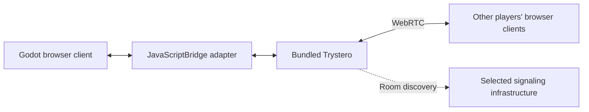

# Browser alpha networking

## Confirmed direction

The alpha is **browser-only**. Players host matches through **WebRTC**, using **Trystero** for room discovery and peer data transport. The Godot 3D client is deployed to GitHub Pages and itch.io. Windows and Linux exports are deferred, so native JavaScript integration is not an alpha requirement.

No dedicated gameplay server is required for this alpha. A player hosting the simulation is distinct from the static website serving the client files. Up to five Commonwealth players still participate in a match.

## Integration basis

[Trystero](https://github.com/dmotz/trystero) provides JavaScript room discovery, peer events, data actions, and configurable WebRTC connectivity. Its public signaling strategies can avoid deploying a custom signaling service. It also supports TURN configuration for networks where peers cannot connect directly.

Godot's [JavaScriptBridge](https://docs.godotengine.org/en/stable/classes/class_javascriptbridge.html) exposes browser JavaScript APIs and callbacks to GDScript and can copy JavaScript binary buffers into Godot byte arrays. The alpha uses this browser-only interface; no native runtime helper or desktop WebRTC extension is needed for its export target.

The repository implements this adapter with **Godot 4.7.2** and **Trystero 0.26.0**, pinned in `.godot-version` and `package-lock.json`. Local browser tests exercise real WebRTC transport, host-confirmed orders through Godot, and terminal host loss. Public hosting and different-network reachability remain unverified. See [implementation status](implementation-status.md).

## Architecture

Bundle Trystero and the adapter with the web export rather than requiring players to install anything. Browser peers reached through GitHub Pages and itch.io use the same application namespace, protocol version, and compatible room configuration, allowing those two deployment locations to join one match.

Trystero manages room connectivity; the game still defines player slots, match ownership, orders, simulation state, visibility, admission, and victory. A transport peer is not automatically an accepted player. Do not assume Trystero data actions are directly compatible with Godot's built-in high-level multiplayer packet format.

Use a narrow adapter between GDScript and JavaScript rather than scattering calls to Trystero throughout gameplay code. The proposed interface provides initialization, room creation/join, targeted packet sending, event polling, and leaving. Events include peer arrival/departure, received packets, connection progress, and failure.

Keep Godot callback references alive while the adapter is active. Queue callback events and consume them at a controlled simulation boundary. A callback does not immediately alter resources, orders, or entities halfway through a simulation step. Explicitly convert binary packets across the bridge and preserve the sending peer identity.

## Authority model and target guarantees

Use **host-authoritative simulation** for the alpha. The room creator is the hosting player and remains a participating player. That browser runs the authoritative fixed-step simulation and Lightless CPU. Other clients send orders and display host-confirmed state.

- Host and client orders pass the same validation: ownership, legal target, range, available resources, queues, and population rules.
- The host assigns player slots and accepts only compatible build/protocol and gameplay-configuration identifiers. Camera and local input preferences remain outside the gameplay hash.
- Messages include a match identifier, sender identity, sequence number, and relevant simulation tick. The host ignores duplicate orders and orders from the wrong owner.
- Keep ordered gameplay commands and acknowledgments separate from replaceable presentation/state updates at the application level. Pin and test the selected Trystero version's actual message behavior rather than assuming a particular unreliable-channel API exists.
- Only the host commits resource deductions, spawns, damage, deaths, elimination, and extraction victory. Clients do not independently award persistent currency from an unconfirmed local outcome.
- Replicate a player's permitted view: visible entities, remembered terrain/resources/structures, and anonymous detected tiles as appropriate. Camera position never grants simulation knowledge. The host player's rendered view follows the same visibility rules as other players.

This does not require independently running Godot physics in deterministic lockstep on every browser. The host is the authority; client interpolation must not change hit, inventory, or movement results. Exact state-packet layout, update frequency, and bandwidth budgets will be measured in the networking prototype.

Trystero may establish room-wide peer connectivity, but gameplay follows a logical host/client model. Clients send gameplay orders to the designated host, not to whichever peer is first discovered. Host identity must be explicit in room setup and handshake. Transport arrival order never changes the winner or the authority.

## Room lifecycle

The proposed initial flow is create room, share an invitation, join, validate compatibility, select player slots/settings, mark ready, and let the host start. The host freezes map seed, game speed, and resolved gameplay configuration at start. Late joining an active match is not yet a defined alpha feature.

The room creator's hosting role is independent of their faction, commander, or continued survival. If eliminated, their game assets follow the elimination rules while their connected browser continues running the authoritative match. Losing an Anchor does not itself end everyone else's network session; leaving the match does.

**Host departure or connection loss ends the match for everyone as soon as it is detected.** Stop the simulation and explain that the host left or disconnected. Do not elect a replacement, transfer authority, retry the host connection, restore a checkpoint, or resume the ended match. There is no host migration or recovery attempt.

**Non-host departure eliminates that player immediately when detected.** Their assets remain under existing orders and stances; vehicles unload all occupants. Their surviving Anchor is not destroyed by the disconnect. Elimination can award last-player victory under the normal multiplayer rules. Reconnection does not restore player control, and no disconnect policy can reopen a match ended by host loss.

## Signaling and connection reachability

Player hosting does not remove the need for peer discovery or network traversal. The adapter uses Trystero's **Nostr** strategy by default, with connectivity configuration separate from balance in [networking.json](../config/networking.json). Development tests can select a local WebSocket signaling relay using the documented URL parameter. GitHub Pages and itch.io serve the client; they do not become a custom signaling or TURN service simply by hosting it.

Try direct peer connections first. Some pairings can require TURN. A TURN relay carries connectivity traffic rather than simulating the game, so using one does not change the player-hosted authority model. Provider choice, availability, and costs remain to be determined. Connection failure must be exposed to the user; never claim universal connectivity from a same-machine test.

No voice/video chat, account service, public matchmaking ladder, or dedicated gameplay backend is added by selecting Trystero. Those are separate potential features, not alpha requirements.

## Required early networking prototype

Before full multiplayer gameplay is built:

1. Export a minimal Godot scene with the bundled Trystero adapter and verify a room can form between two independent browser sessions.
2. Exchange a typed command and binary payload in both directions, preserve peer identity, and verify byte-for-byte receipt through the Godot bridge.
3. Identify the creator as host and demonstrate one host-confirmed state change on both clients, including rejection of duplicate or unauthorized ownership requests.
4. Join a GitHub Pages client to an itch.io client using the same room. Test the actual Pages subpath and itch.io frame, not only a local standalone HTML page.
5. Repeat over different networks and verify direct connectivity, configured TURN fallback if available, and understandable failure states when connectivity cannot be established.
6. Scale the test to five peers, measure message delay/throughput, and check host frame time in the single-threaded export.
7. Verify host departure or detected connection loss ends every client's match without migration, retry, or resumption. Separately test a host player being eliminated while staying connected, browser focus changes, and non-host departure according to its eventual policy.

The local prototype now demonstrates cross-origin browser room formation, binary transport with five peers, host-confirmed movement, and terminal host loss. Command sequencing and ownership checks are implemented, but hostile-protocol testing remains pending. Full gameplay replication, actual Pages/itch.io rooms, different networks, TURN, and measured five-player load remain release gates; desktop interoperability is deferred.

## Transport liveness

`config/networking.json` exposes `liveness.heartbeatIntervalMs` (1000 ms) and `liveness.peerTimeoutMs` (10000 ms). The timeout must exceed the heartbeat interval. Peers exchange small health messages on a separate Trystero action; any gameplay packet also refreshes that peer's deadline. The monotonic browser timer runs independently of simulation pause and speed.

A missing host ends the guest match without recovery. A missing guest is eliminated by the host under the existing keep-assets-and-orders policy. Explicit departure and timeout share one deduplicated path; late packets from an expired peer are ignored. Leaving a session clears its timer and deadlines, and callbacks from older sessions cannot affect a new one. Browser/device suspension longer than the configured timeout is treated as disconnection. This bounds host-loss detection without depending on WebRTC's eventual peer-leave event.
